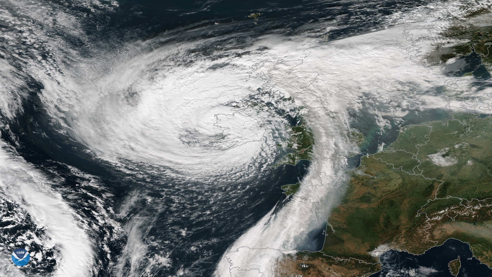

An unusual and devastating storm struck Ireland in the early hours of October 16, 2017. [Record-breaking gusts](https://www.irishtimes.com/news/environment/storm-ophelia-facts-and-figures-of-the-strongest-east-atlantic-hurricane-in-150-years-1.3260475) of up to 119mph left 360,000 homes without electricity and, sadly, three people [lost their lives](https://www.bbc.co.uk/news/uk-41627442). The storm continued north-eastwards, causing power outages and damage across the UK and Scandinavia over a two-day period.

That storm, named Ophelia, was exceptional. Hurricanes and tropical storms typically originate in the warm waters of the deep tropics, but Hurricane Ophelia formed close to the Azores—an island chain 1,400km west of Portugal and more than 800km north of the Tropic of Cancer. A Category-3 hurricane at its peak, no major tropical storm on record has ever ventured so close to Europe.

Ophelia weakened, becoming an ex-hurricane, before it hit Europe. But with its spiral of clouds and an eye at its centre, it still resembled a tropical storm and had the intense winds and rainfall of one too. As a tropical-like storm, Ophelia is extraordinary among the weather systems which have reached the British Isles.

  
***Figure 1*** | *Ex-hurricane Ophelia striking the British Isles on October 16, 2017. NOAA National Environmental Satellite, Data, and Information Service (NESDIS).*

A year later, Storm Helene developed off the coast of West Africa and took a [highly unusual shortcut](https://theconversation.com/rogue-hurricanes-that-head-northwards-may-be-new-normal-103359) to the UK, and Storm Leslie reached the Iberian Peninsula. In 2019, several tropical storms started out in an area of the tropical Atlantic known to scientists as the [main development region](https://twitter.com/michaelrlowry/status/1021431791117271042?lang=en), and eventually reached Europe as weak remnant storms, swept along by the jet stream.

Clearly, tropical storms and their impacts are not confined to the tropics. So, is the landfall of tropical-like storms across Europe a growing threat, and might climate change, as [studies have suggested](https://theconversation.com/the-future-will-bring-hurricanes-to-europe-16339), be responsible? To answer this, we must start with a simpler question: how often do tropical-like storms actually reach western Europe?

### Finding good data  

Official records of hurricanes and tropical storms largely concern those threatening the US and are less reliable for Europe. Records only expanded to properly include Europe as recently as the early 1990s, and they become increasingly patchy the further back in time scientists look.

Before weather satellites, which track storm systems, meteorologists relied on measurements made from reconnaissance aircraft, involving dangerous and often impossible work, and from ships, which travel in lanes and can only observe a limited area. As a result, storms are missing from official records, and [studies have shown](https://journals.ametsoc.org/view/journals/clim/31/11/jcli-d-15-0537.1.xml) many of the missing events likely formed in the eastern Atlantic—exactly where Ophelia, Helene and the tropical-like storms that threaten Europe originated.

In [a new study](https://agupubs.onlinelibrary.wiley.com/doi/10.1029/2020JD033924), we turned to global data sets provided by [NASA](https://gmao.gsfc.nasa.gov/reanalysis/MERRA-2/), the [European Centre for Medium-Range Weather Forecasts](https://www.ecmwf.int/en/forecasts/datasets/reanalysis-datasets/era5), and other government agencies. These data sets combine all the available weather observations with state-of-the-art computer models, which use the laws of physics to help fill in the gaps. We searched these data sets using an algorithm that scours the data to find every tropical storm that reached Europe, including storms absent from official records.

### Storm risk  

Over the period 1979–2018, we found that, on average, one to two storms that reached Europe each year were initially tropical storms. Typically, they occurred in September and October, around the peak of the North Atlantic hurricane season. However, the characteristics and strengths of these storms has varied a lot.

Scientists have known for several decades that, when hurricanes and weaker tropical storms travel north, they transform into what we call extratropical storms—the kind Europe is used to seeing during winter. In fact, around half of all tropical storms do this, but, fortunately, most aren’t damaging.

Among the other half, however, we found that some, like Ophelia, keep their tropical shape and characteristics for longer before petering out. This is crucial. The tropical-like storms that make landfall are typically much stronger. Of all the storms reaching Europe from the tropics, one in ten kept its tropical characteristics and strength to landfall. That’s one every five years over the past four decades, according to our analysis.

So, over the last 40 years, storms which were initially tropical were not that unusual across Europe. Searching new data sets and using advanced algorithms has revealed they’re more common than many scientists previously thought. Fortunately, many weaken substantially before they reach European coastlines, but, as Ophelia demonstrated, that isn’t always so—and climate change may make weakening less likely in the future.

North Atlantic sea surface temperatures have increased by [1.5°C since 1870](https://agupubs.onlinelibrary.wiley.com/doi/abs/10.1029/2020GL090677), and continued warming is expected to make future tropical storms [more intense](https://sciencebrief.org/topics/climate-change-science/cyclones). Stronger tropical storms are not only [more likely to reach Europe](https://agupubs.onlinelibrary.wiley.com/doi/full/10.1002/grl.50360), but more likely to maintain their tropical intensity rather than weakening.

Comparing recent years with earlier decades, we found some evidence that this trend is already emerging. Storms with tropical origins have reached Europe more frequently since 2000 than during the 1980s and 1990s. This is intriguing, to say the least, but more analysis is needed to verify—and explain—these trends, as well as the varied storm threats Europe faces. ♦

### Author’s note

This article was originally published in [*The Conversation*](https://theconversation.com/severe-storms-from-tropics-reach-europe-once-every-five-years-on-average-new-research-159669) with additional graphics and under the title 'Severe storms from tropics reach Europe once every five years on average—new research'. At the time of writing, this article had also been republished under the [CC BY-ND 4.0](https://creativecommons.org/licenses/by-nd/4.0/) licence by:

[UN Office for Disaster Risk Reduction (PreventionWeb)](https://www.preventionweb.net/news/view/77915)  
[yahoo!news](https://uk.news.yahoo.com/severe-storms-tropics-reach-europe-151314623.html?guccounter=1)  
[Connecting Research (University of Reading)](https://research.reading.ac.uk/research-blog/severe-storms-from-tropics-reach-europe-once-every-five-years-on-average-new-research/#more-22037)  
[ForeignAffairs.co.nz](https://foreignaffairs.co.nz/2021/05/19/mil-osi-global-severe-storms-from-tropics-reach-europe-once-every-five-years-on-average-new-research/)  
[FLIPBOARD](https://flipboard.com/@ConversationUK/severe-storms-from-tropics-reach-europe-once-every-five-years-on-average-new-r/a-jlA-MWY-RV2qe7pfq7oBUA%3Aa%3A2015704639-c41ac5bd5e%2Ftheconversation.com)  
[Acclimatise: building climate resilience](https://www.acclimatise.uk.com/2021/05/31/severe-storms-from-tropics-reach-europe-once-every-five-years-on-average-new-research/)  

### References

Baker, A. J., Vannière, B., and Vidale, P. L. [On the realism of tropical cyclones simulated in global storm-resolving climate models](https://agupubs.onlinelibrary.wiley.com/doi/10.1029/2024GL109841). *Geophysical Research Letters* **51**, e2024GL109841.
