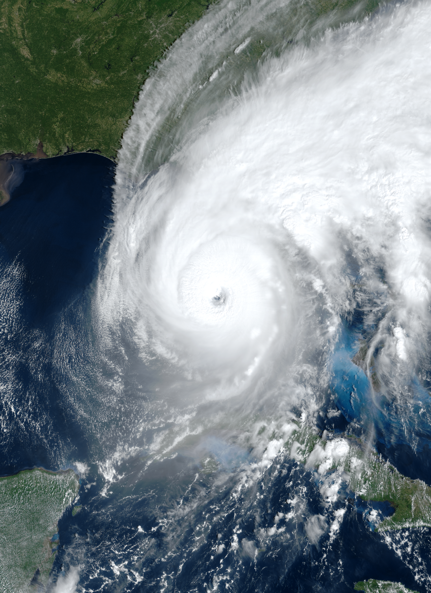
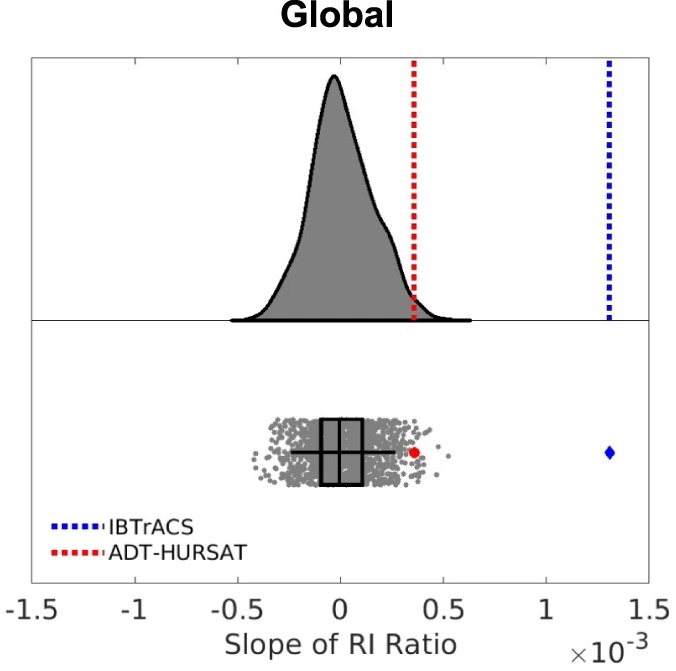

Tropical cyclones are among the most devastating natural hazards. Last September, category-4 Hurricane Ian became one of the most costly hurricanes on record. In Florida alone, there were 146 fatalities and tens of thousands of people displaced. Estimated losses across the Caribbean and several US states will likely exceed $110bn. Hurricane Ian (Figure 1) was an example of *rapid intensification*, when storm winds strengthen quickly, transforming a moderate tropical storm into a major hurricane in a single day.

  
***Figure 1*** | *Category-4 Hurricane Ian approaching Florida's west coast at peak intensity on 28th September, 2022. Image from [registry.opendata.aws/noaa-goes](https://registry.opendata.aws/noaa-goes/).*

Rapid intensification events—when a tropical cyclone’s winds increase by at least 30 kt (~55 km/h) in 24 hours—often lead to destructive hurricane landfalls. This is not only because they generate some of the strongest storms but also because accurately forecasting rapid intensification, although improving, remains a huge challenge. Emergency services and at-risk communities can face evacuation and other measures with little warning. These are reasons why the international scientific community, as well as regional and national governments, are concerned about what effects climate change may have on rapid intensification of tropical cyclones.

[Recent research](https://www.nature.com/articles/s41467-019-08471-z) identified upward trends in rapid intensification in several ocean basins, including the North Atlantic, but whether or not these trends are a consequence of anthropogenic climate change is an issue not yet properly explored. A [new study](https://www.nature.com/articles/s41467-022-34321-6), led by Kieran Bhatia at Guy Carpenter, addressed this, focussing on two important questions: how have the factors known to cause rapid intensification changed over recent decades, and is there a human fingerprint on these changes?

We analysed the key meteorological factors that make rapid intensification possible: high humidity in the atmosphere and warm sea-surface temperatures, which provide the fuel for a tropical cyclone’s intensification. We also examined an important factor in slowing or preventing intensification: wind shear, which is a measure of how wind speeds vary at different altitudes in the atmosphere. Each of these environmental factors plays a role in the likelihood of rapid intensification.

Our research team analysed humidity, sea-surface temperatures, and wind shear in the vicinity of tropical cyclones, and more generally across the tropics, over the period 1982–2017. We found that global trends in these environmental factors are making rapid intensification events more likely. We also analysed high-resolution climate model simulations as well as [simulations performed for the latest (6th) IPCC Assessment Report](https://www.wcrp-climate.org/wgcm-cmip/wgcm-cmip6), and found that the trends we identified are unlikely to be a feature of natural variability in the climate system (Figure 2). We instead concluded that anthropogenic warming is favouring storm environments that significantly increase the probability of rapid intensification.

  
***Figure 2*** | *Observed global trends in the proportion of tropical cyclones that undergo rapid intensification (red and blue lines) lie outside natural variability of the climate system (grey distribution), which was quantified in climate simulations performed without anthropogenic greenhouse-gas emissions. Figure adapted from [Bhatia et al., 2022](https://www.nature.com/articles/s41467-022-34321-6").*

Overall, rapid intensification remains a relatively rare occurrence, but this new research calls for immediate efforts to improve coastal resilience to prepare for the rising probability of these costly events. [Our study](https://www.nature.com/articles/s41467-022-34321-6) was published in the week that [COP27](https://cop27.eg/#/) was underway in Sharm El-Sheikh, Egypt, where climate risk and adaptation to climate change took centre stage. The need to adapt to more frequent rapid intensification of tropical cyclones globally is just one of many ongoing and profound changes in risk engendered by continued warming of the climate. Policy choices to reduce greenhouse-gas emissions will help mitigate dangerous climatic shifts. ♦

### Author's note

This blog is also published by the University of Reading on *[Connecting Research](https://research.reading.ac.uk/research-blog/upward-global-trends-rapid-intensification-tropical-cyclones/)*.

### References

Bhatia, K. T. *et al*., 2022. [A potential explanation for the global increase in tropical cyclone rapid intensification](https://www.nature.com/articles/s41467-022-34321-6). *Nature Communications* **13**, 6626.
